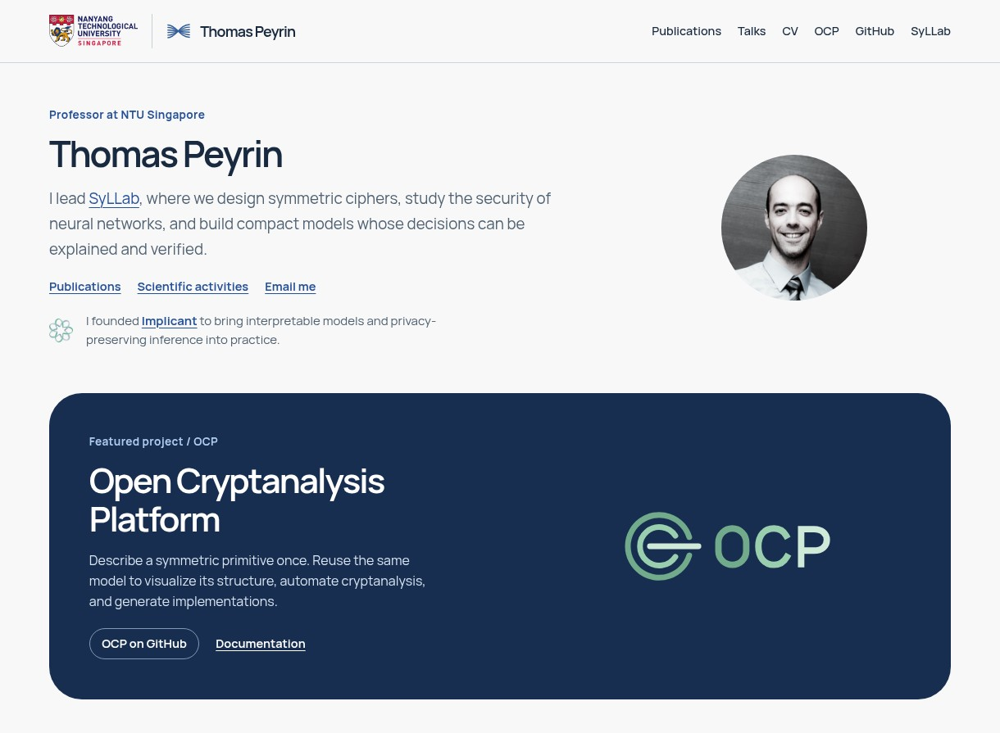
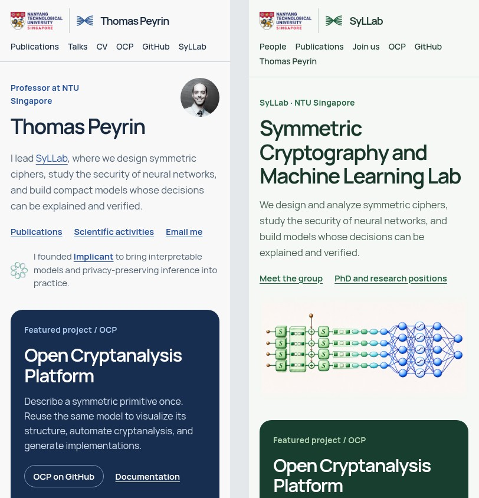

# Thomas Peyrin and SyLLab

## OCP logo study

The C is centered within the outer O. A horizontal stroke joins the C at its leftmost bend and extends through the gap in the outer O. Each element uses a progressively lighter green.

[View the logo on a light background](ocp-nested-p.svg)

## Website layout previews

The SyLLab screenshots and PDF below show the earlier artwork. The approved cipher-to-neural-network illustration is pending in the draft.

[Homepages and GitHub activity pages (PDF)](Website-Preview.pdf) · [Phone layouts](mobile-preview.jpg)

### SyLLab

### Thomas Peyrin

### Phone layouts

