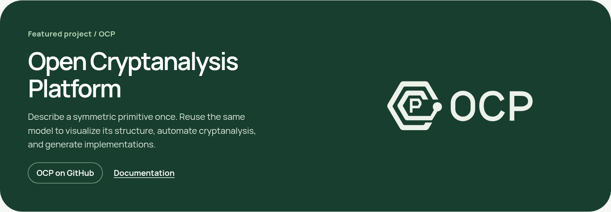
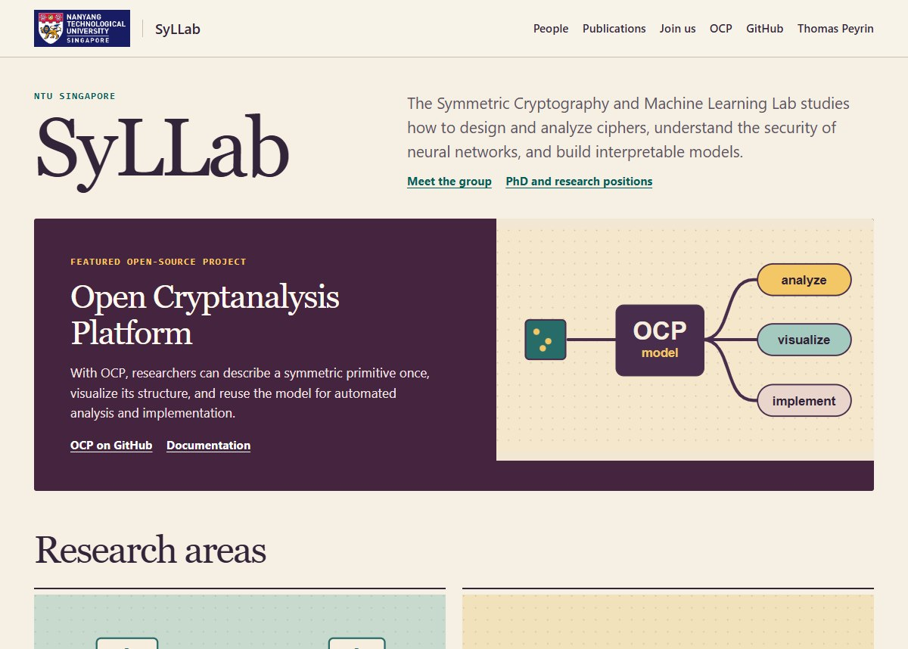

# Thomas Peyrin and SyLLab

## OCP logo study

The P sits inside the original nested O and C. Here is the mark at its intended size on the SyLLab homepage.

[View the logo on a light background](ocp-nested-p.svg)

## Website layout previews

The SyLLab screenshots and PDF below show the earlier artwork. The approved cipher-to-neural-network illustration is pending in the draft.

[Homepages and GitHub activity pages (PDF)](Website-Preview.pdf) · [Phone layouts](mobile-preview.jpg)

### SyLLab

### Thomas Peyrin

### Phone layouts

