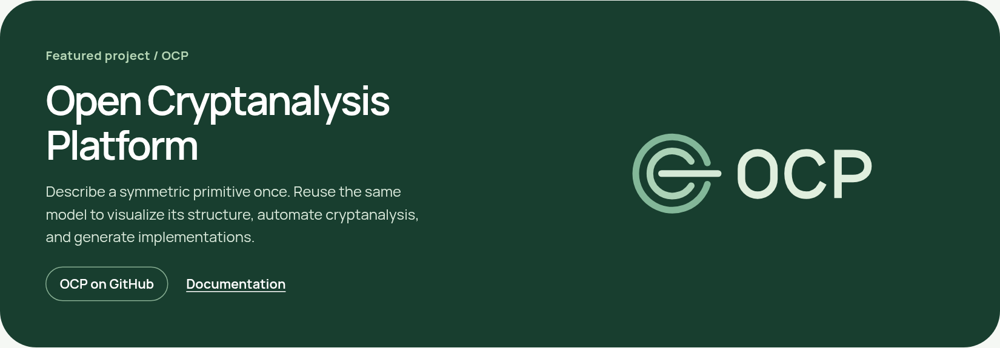

# Thomas Peyrin and SyLLab

## OCP logo study

Both studies use three greens and a horizontal line with a small gap before the C. The rounded version uses two concentric circular arcs and rounded stroke ends.

| Rounded | Angular |
| --- | --- |
|  |  |

[Compare the angular version on the project card](ocp-feature.png)

## Website layout previews

The SyLLab screenshots and PDF below show the earlier artwork. The approved cipher-to-neural-network illustration is pending in the draft.

[Homepages and GitHub activity pages (PDF)](Website-Preview.pdf) · [Phone layouts](mobile-preview.jpg)

### SyLLab

### Thomas Peyrin

### Phone layouts

